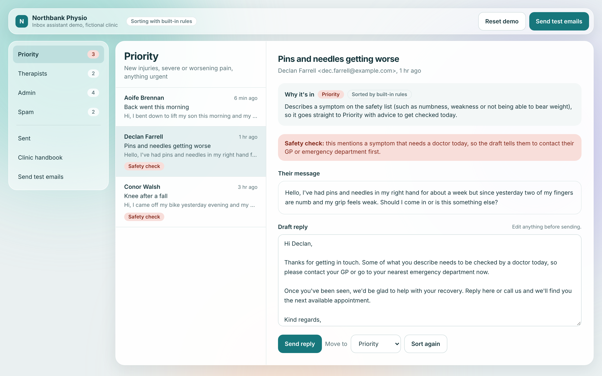

# Inbox triage for a small clinic

Sorts a clinic's inbox into folders, drafts replies from the clinic's handbook, and learns from staff edits.

**[Live demo](https://cian-email-triage.vercel.app)** · **[Portfolio](https://cianmccaul.vercel.app)**



## What it does

An assistant for a clinic's reception inbox. It sorts each email into **Priority**, **Therapists**, **Admin** or **Spam**, explains why, drafts a reply using the clinic's own handbook, and **learns from the changes staff make** before they press send.

This is a public demo of a tool I built for a physiotherapy clinic in Dublin. The clinic here, **Northbank Physio**, is fictional, and every patient and email in the demo is made up.

## Run it locally

The live demo needs no sign-up. The badge at the top of the app says which sorter is running. To run it yourself:

```
npm install
npm run dev
```

Open http://localhost:3000. **No API keys needed.** Without a key, a built-in rule-based sorter does the work, so the demo always runs. Add a free [Groq](https://console.groq.com) key to `.env.local` to sort with an AI model instead:

```
GROQ_API_KEY=your-key
```

Optional settings (see `.env.example`):

| Variable | Default | What it does |
|---|---|---|
| `AI_ENABLED` | on | `false` switches the AI off without removing the key, so the built-in rules do everything |
| `AI_DAILY_LIMIT` | `20` | AI calls each visitor gets per day (sorting and learning both count) |
| `GROQ_MODEL` | `llama-3.3-70b-versatile` | Any Groq chat model that supports JSON output |

### Things to try

1. **Watch the inbox sort itself.** The sample inbox arrives unsorted and each email lands in its folder one at a time.
2. **Send test emails.** The test panel has 12 ready-made emails, each labelled with where it *should* land. Press **Send all 12** and the results table shows every pass. Some are deliberately tricky:
   - *"URGENT: invoice overdue"* uses the word urgent but belongs in Admin, not Priority.
   - *"My back is loads better, please cancel"* mentions pain but is a cancellation.
   - A chatty message about parking that also mentions a **numb foot** is a safety issue and goes to Priority.
   - A polite "partnership opportunity" that's really SEO spam.
3. **Write your own** email as a patient and see where it lands.
4. **Teach it something.** Open Siobhan's email in Admin, add *"Students get 10% off with a valid student card."* to the draft, and send. The new rule appears in **Clinic handbook** under *Learned from your edits*, and the AI follows it in future drafts. (Learning works without a key too, but only AI drafts use the learned rules; the built-in sorter writes its own stock replies.)

## How it works

```
email ──► /api/triage ──► AI available? ──yes──► Groq (Llama 3.3) ──► validate answer ──┐
                              │                                      (invalid? errors?) │
                              no ──────────────► built-in rules ◄──────────────────────┘
                                                      │
                              safety check runs on every email
                                                      ▼
                                   folder + reasoning + draft reply

staff edit + send ──► /api/learn ──► what did they add? ──► new rule in the handbook
```

**Safety comes first.** Some symptoms (new numbness or weakness, chest pain, bladder or bowel changes, not being able to bear weight) need a doctor, not a physio appointment. A red-flag check runs on every email whichever sorter is used. If the AI puts one of these anywhere but Priority, the safety check overrules it, and the reply tells the patient to contact their GP or emergency department first.

**The AI's answer is never trusted blindly.** It's parsed and validated with Zod. Near-miss folder names ("Therapists", "ADMIN") are mapped onto real folders. Anything else, or a timeout or error, falls back to the rules. Spam never gets a reply, even if the model wrote one.

**Urgency needs a symptom.** Words like "urgent" or "today" only push an email towards Priority when there's also a symptom. That's what stops the overdue invoice getting flagged as a clinical emergency.

**Replies only use facts from the handbook.** The handbook is editable in the app, so changing a price or opening time changes future AI drafts.

**AI use is limited, so one visitor can't use up the free tier for everyone.** Each visitor gets `AI_DAILY_LIMIT` AI calls a day (20 by default), tracked with an anonymous cookie, and each IP address gets three visitors' worth, so clearing cookies doesn't reset it. When Groq says its quota is used up, AI pauses for everyone until Groq's retry time. Either way, the built-in rules take over and the app says why. The counts are kept in the server's memory, so this is best effort: a restart clears them, and separate server instances count separately. Groq's own quota is the hard limit behind it.

**The demo state lives in the browser.** It's saved to localStorage, so it survives a refresh. **Reset demo** starts again.

## Project structure

```
src/
  app/
    api/triage/route.ts    validates the request, sorts one email
    api/learn/route.ts     turns a staff edit into a rule
    page.tsx               the app
  components/
    InboxProvider.tsx      state, sorting queue, learning, saving to the browser
    FolderView.tsx         email list and detail with the editable draft
    TestBench.tsx          test emails, live results and "write your own"
    OtherViews.tsx         sent replies and the clinic handbook
  lib/
    folders.ts             the one list of folders everything uses
    triage/rules.ts        built-in sorter and red-flag check
    triage/ai.ts           prompt, and validation of the AI's answer
    triage/index.ts        AI first, rules as fallback, safety check always
    learn.ts               learning from edits, with and without AI
    ai-limits.ts           kill switch, per-visitor daily limit, pause when Groq's quota runs out
    visitor.ts             the anonymous visitor cookie used for the limit
    handbook.ts            the fictional clinic's facts
    sample-inbox.ts        the morning's sample emails
    test-emails.ts         the test emails and where each should land
tests/                     Vitest: sorter, safety, AI parsing, learning, AI limits
```

## Tests

```
npm test
```

51 tests (Vitest, in `tests/rules.test.ts`, `tests/ai-parse.test.ts` and `tests/ai-limits.test.ts`), including one that checks **every test email and sample email lands in its expected folder**, so a change to the sorter that breaks a case fails straight away.

## Built with

Next.js 16, React 19, TypeScript, Tailwind CSS 4, Zod, Groq (Llama 3.3 70B), Vitest.

## From the real version to this demo

The version I built for the clinic pulled email from Outlook and stored it in Supabase. This demo keeps the sorting, safety and learning logic, and replaces the mailbox with sample and test emails, so anyone can run it without access to real patient data.

---

Built by [Cian McCaul](https://github.com/cianmccaul).
